# Architecture: AI-Driven Capitation Revenue Reconciliation

> **Status: as built** (prototype on synthetic data). Started from a plan frozen after two design reviews;
> section 13 lists every place the build differs from that plan. Why each choice was made: `docs/DECISIONS.md`.
> Measured results: `evals/results.md`. Slides: `deck/Capitation_Reconciliation.pptx`.

**Design mantra:** *Code computes. AI reads and explains. Humans approve.*

---

## 1. The problem in one paragraph

A health plan is paid a fixed amount per member per month (PMPM) by the state. The amount depends on the member's
**rate cell** (region x eligibility category). Rates change mid-year and sometimes **retroactively**, in documents
that arrive as PDFs, spreadsheets or emails. Every month finance must work out what it should have earned, reconcile
that to what the state **remitted** (member-level detail) and what reached the **bank**, explain every gap, and restate
months already closed. Today that is manual, slow and depends on a few people.

## 2. Assumptions (stated, not hidden)

| Area | Assumption |
|---|---|
| Program | Medicaid-style capitation; PMPM set by rate cell (4 regions x 4 categories = 16 cells) |
| Sources | Enrollment (834-like), remittance (820-like, member lines + batch header), bank deposits, rate documents |
| Proration | First-of-month: a member earns the month if covered on day 1 (pluggable strategy) |
| Prior-period changes | Retroactive **rate** changes and late-arriving **enrollment** (retro terminations parked) |
| Granularity | Member-month reconciliation, plus remittance-batch-to-deposit |
| Accounting | Illustrative accounts: Dr Capitation Receivable / Cr Capitation Revenue (close) or Revenue - Prior Period Adjustment (retro) |
| Data | 100% synthetic, fictional state ("Westlake DHS"), invented people; built as if it were real PHI |

---

## 3. System context

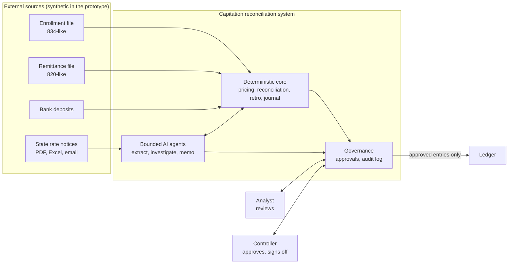

---

## 4. Prototype architecture (as built)

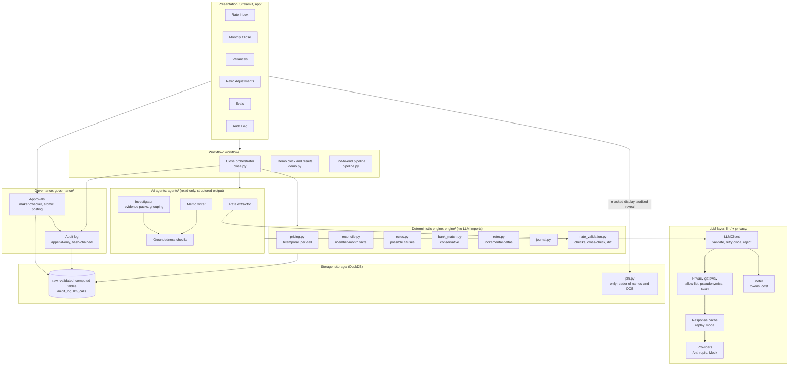

### Module boundaries, enforced by a test (`tests/test_import_boundaries.py`)

| Module | Must NOT import | So that |
|---|---|---|
| `engine/` | `llm/`, `agents/`, `storage.phi` | no model can influence a dollar; money math never needs identity |
| `agents/` | `storage.phi`, `governance.approvals` | agents can't reach names/DOB and can propose but never commit |
| `governance/` | `llm/` | approvals are human or deterministic only |

There is also **no free-text path to a model**: `LLMClient.call` accepts only a structured payload, which always passes
the privacy gateway.

---

## 5. Data architecture: three layers plus the audit trail

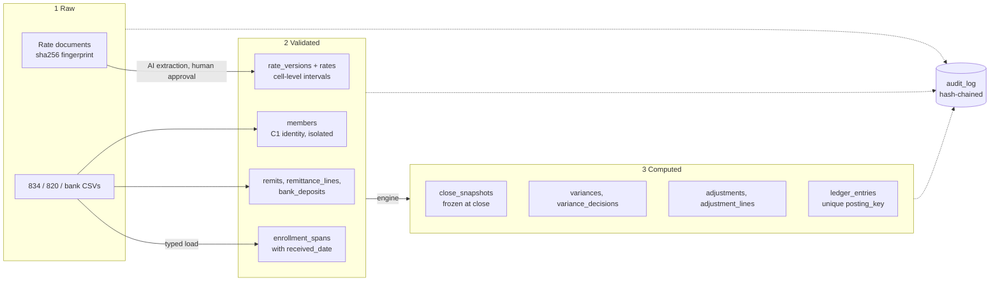

Maps to **bronze / silver / gold** in production. Money is `DECIMAL(12,2)` in the database and `Decimal` in code;
floats are rejected at the schema boundary. Every field carries a privacy class (C1 identity, C2 PHI, C3 financial,
C4 public).

### Bitemporal rates: the key idea

Each rate row has an **effective interval** (which months it applies to) and inherits **knowledge time** from its
version's approval (when we accepted it as true).

```
price(member, month, as_of):
    span = latest-received span covering day 1 of the month, received on or before as_of
           (two different spans received the same day -> ENROLLMENT_CONFLICT)
    rate = for THIS cell, among rows of versions approved on or before as_of that cover the month,
           the one approved last                      (none -> UNPRICED, never a silent $0)
```

- **Precedence is per cell**, so an amendment touches only the cells it names.
- **Current status never filters history**: `superseded` is a display label.
- **What was booked** is frozen in `close_snapshots`. A retro delta is `new expected - previously booked`, where
  previously booked = snapshot + every non-rejected earlier adjustment. A second revision books only its increment.
- The same mechanism covers **late enrollment**, because spans carry knowledge time too (`received_date`).

---

## 6. Monthly close workflow (as built)

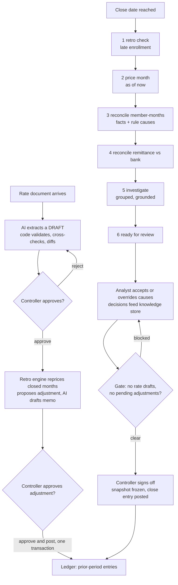

Every step writes an audit event and records progress in `close_runs`, so a failed run resumes after the last completed
step. The steps are idempotent. There is no workflow framework: six sequential steps don't need one (production would use Durable Functions).

---

## 7. Retroactive change: the headline scenario

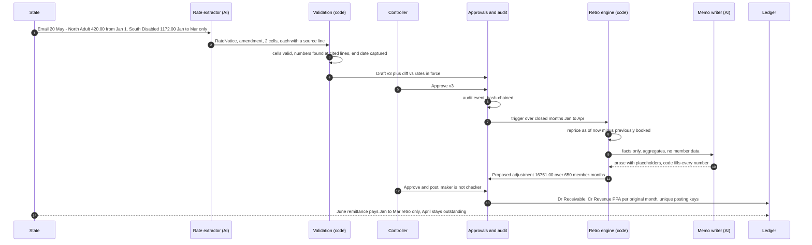

The two-cell amendment is deliberately tricky. South Disabled is corrected for **January–March only**, because the April
rate sheet already set a new rate from April. With per-cell precedence the v3 change can't leak into April, and the
validation step flags an amendment whose end date has gone missing.

---

## 8. Agents: boundaries, tools, guardrails

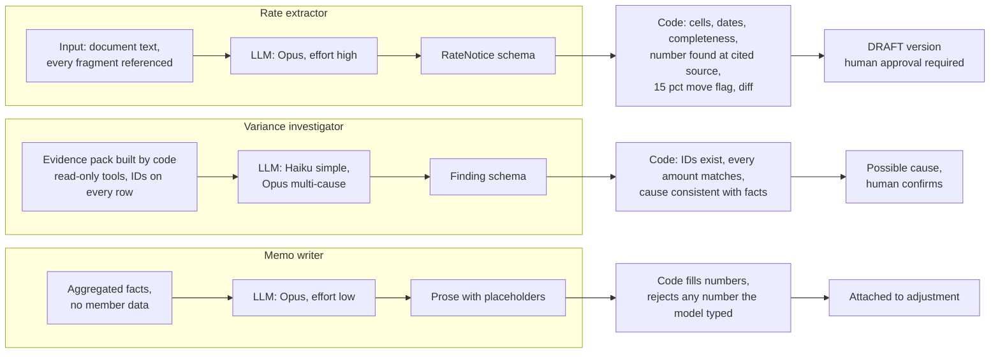

| | Extractor | Investigator | Memo writer |
|---|---|---|---|
| One job | Document → structured rate notice | Explain a group of similar variances | Explain an adjustment in prose |
| Sees | Document text only, **no member data** | One group's evidence pack (pseudonymous) | Aggregates only |
| Tools | None | Read-only: enrollment history, rate history, remittance lines, bank deposits, prior decisions | None |
| Writes | Nothing; workflow saves a draft | Nothing; workflow stores a *possible* cause | Nothing; workflow attaches the memo |
| Gate | Validation + source cross-check + human approval | Groundedness + human accept/override | Number check + human approval of the entry |

**Evidence pack instead of a free-roaming agent.** Code calls the read-only tools and hands the model one bundle.
That makes runs reproducible, cacheable, cheap and measurable. **Grouping** means the model is called once per
pattern, not once per row: 462 variances become 140 calls. **Rules first**: clear single-cause cases (95%) need no
model at all, and triage-only mode makes 19 calls for the half-year.

---

## 9. The LLM call path and privacy gateway

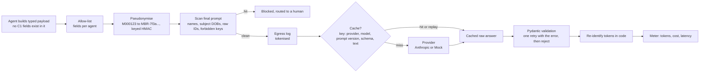

| Control | Built in the prototype | Production |
|---|---|---|
| Classification | C1–C4 tag on every schema field; a test proves names/DOB live only on `Member` | Microsoft Purview with the same classes |
| Minimum necessary | Per-agent allow-lists; extractor sees no member data; memo sees aggregates | Same |
| Pseudonymisation | Keyed HMAC tokens for member IDs (secret in `.env`) | Key Vault, rotation |
| Scan-and-block | Final prompt scanned; DOB check scoped to the payload's members (avoids birthday false positives) | Same, plus alerting |
| Storage | Names/DOB readable only via `storage/phi.py`; engine and agents can't import it | Row/column security, encryption at rest (CMK) |
| UI | Names masked; reveal is controller-only and audited (name never logged) | Entra ID RBAC, PIM for reveal |
| Logs, cache, exports | Tokenised cache; redacting log filter; audit refuses identity fields; exports exclude names | WORM audit storage, retention policy |
| Vendor | (Mock by default) | BAA, Azure OpenAI in-tenant, private endpoints, no public egress |

We claim **pseudonymisation + minimum necessary + a BAA-covered provider**, not HIPAA Safe Harbor de-identification
(coverage months and regions still relate to individuals).

---

## 10. Governance: state machines

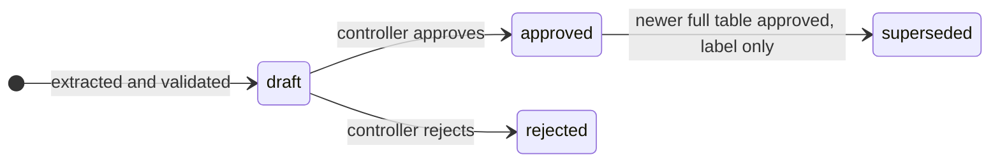

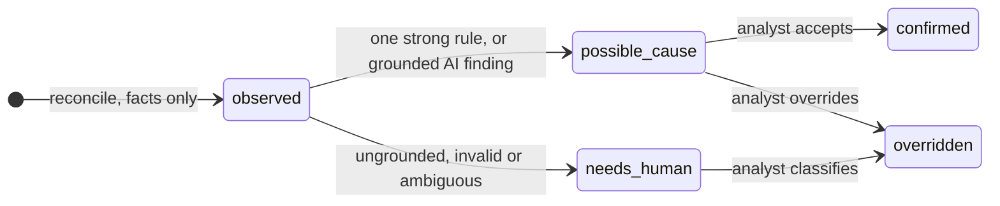

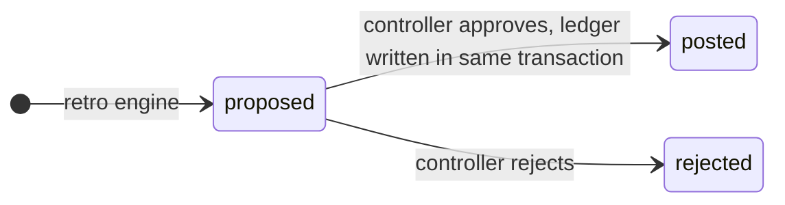

Rules:
- Every transition writes its audit event in the **same transaction**. No audit event means no state change.
- **Maker-checker**: whoever proposes an adjustment can't approve it.
- **Approve = post**: there is no "approved but not posted" state, and a unique `posting_key` makes a retry a no-op.
- **Period lock**: a closed month changes only through an approved adjustment.
- A draft with validation **errors** can't be approved; **flags** only warn.

---

## 11. Repository map

```
schemas/      Pydantic models with privacy tags; LLM output models reject unknown fields
storage/      schema.sql, typed repo, raw loader, phi.py (identity reader)
privacy/      gateway, pseudonymiser, scanner, masking, redacting logger
llm/          LLMClient, providers (Anthropic, Mock), cache, meter, prompts/*.md (versioned)
engine/       pricing, proration, reconcile, rules, bank_match, retro, journal, rate_validation
agents/       doc_parse, rate_extractor, evidence + tools, investigator, groundedness, memo_writer, mock_responders
governance/   approvals (incl. variance decisions, audited reveal), audit (hash chain)
workflow/     deterministic_close, close (orchestrator), demo (clock, resets), simulate, pipeline
app/          Streamlit: Home + 6 pages
data_gen/     synthetic world, 3 rate documents, ground truth
evals/        metrics, adversarial, privacy eval, charts, results.md
tests/        151 tests, incl. hand-written edge cases and the full half-year vs ground truth
```

---

## 12. Target production architecture (Azure, not built)

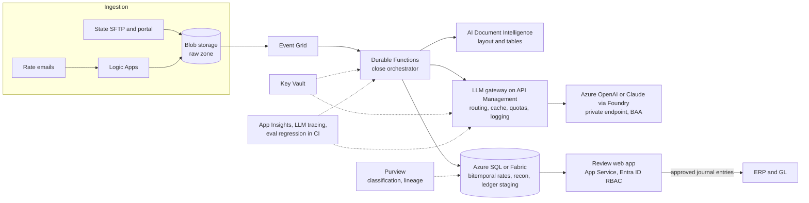

| Prototype piece | Production equivalent |
|---|---|
| CSV loader, file hashes | Blob raw zone, Event Grid triggers, idempotent ingestion |
| `doc_parse.py` | AI Document Intelligence for layout and tables, then the same extractor + validation |
| `LLMClient` + privacy gateway + cache | LLM gateway (APIM): routing by cost/latency, failover, semantic cache, quotas, audit |
| DuckDB | Azure SQL / Fabric (bitemporal tables, ledger staging), Purview classification |
| `workflow/close.py` | Durable Functions orchestration with the same steps and gates |
| Streamlit + role switcher | Internal web app, Entra ID, server-side maker-checker, PIM |
| `evals/` | Eval regression in CI on every prompt or model change; drift monitoring |

---

## 13. Plan vs. built

| Planned | Built | Note |
|---|---|---|
| Bounded tool loop for multi-cause cases | **Not built** | The evidence pack was enough; rules + LLM reaches 100% on multi-cause (mock). |
| Local ledger, hash-chained audit, knowledge store | Built | Knowledge store = accept/override decisions reused as context (overrides first). |
| Approval then posting | **Merged into one atomic step** | Review 2: removes "approved but unposted" states. |
| Rule confidence numbers | **Replaced by strong/weak** | Review 1: no invented calibration. |
| DOB scan across all members | **Scoped to the payload's members** | Found in the first end-to-end run (D40). |
| Cache key without provider | **Provider added** | Found while building replay (D44). |
| Retro enrollment incl. terminations | Late-arriving coverage only | Retro terminations parked (D33). |
| Demo clock, scenario resets, retro recovery button | **Added** | Needed for a bitemporal demo (D50, D52). |

---

## 14. Risks and limitations

| Risk / limitation | Mitigation or next step |
|---|---|
| AI-side numbers so far measured on the mock | One live run with an API key, then replay. The eval harness and cache are ready. |
| Extraction swap of two cells *with* their references passes the cross-check | The approver's diff review is the control; shown openly in the guardrails chart. |
| Synthetic data is cleaner than real 820/834 feeds | Real EDI parsing, reference-data mapping, data-quality rules. |
| Retro terminations, mid-month proration variants | Strategy hooks exist (proration); termination supersession rule to design. |
| Single-user prototype (DuckDB, Streamlit) | Production stack in section 12. |
| Accounting policy assumed | Confirm accounts and PPA treatment with finance; journal is isolated in `engine/journal.py`. |
