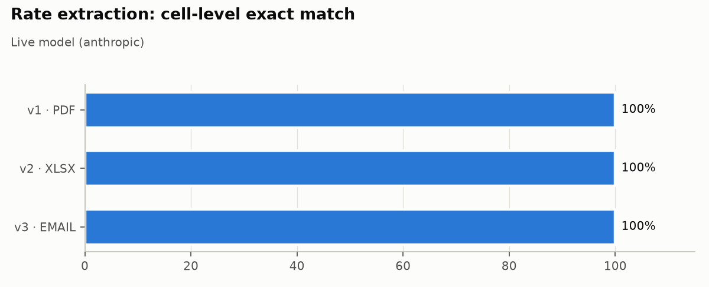
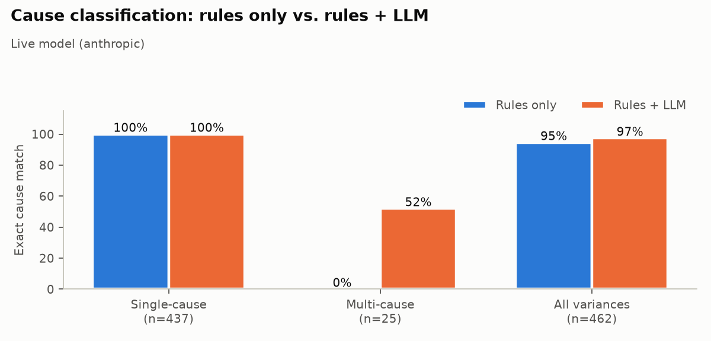
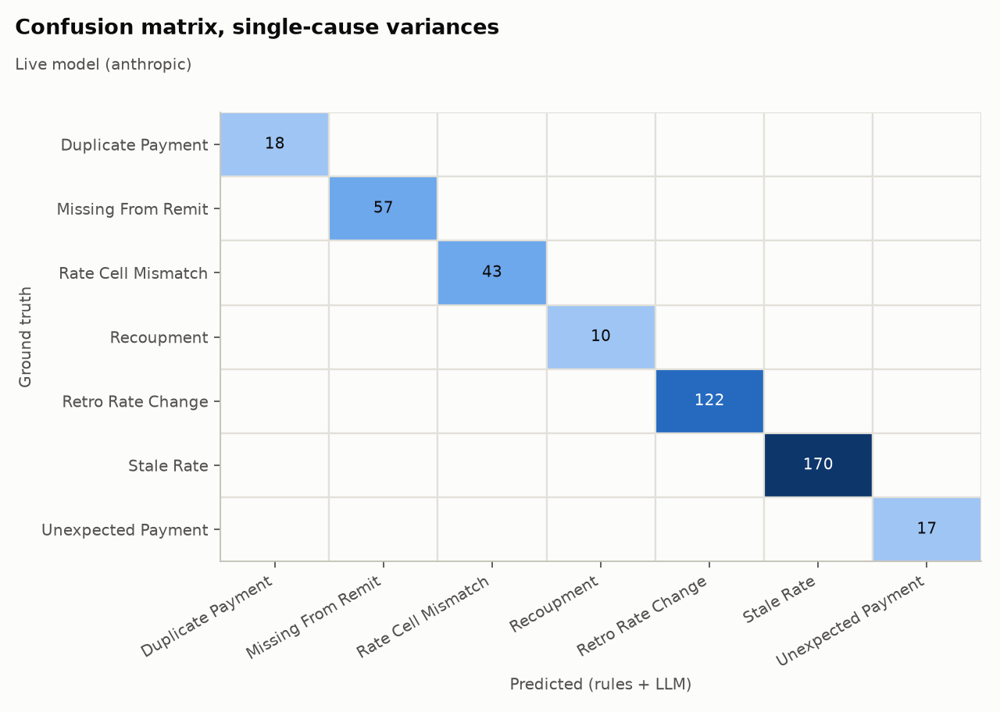
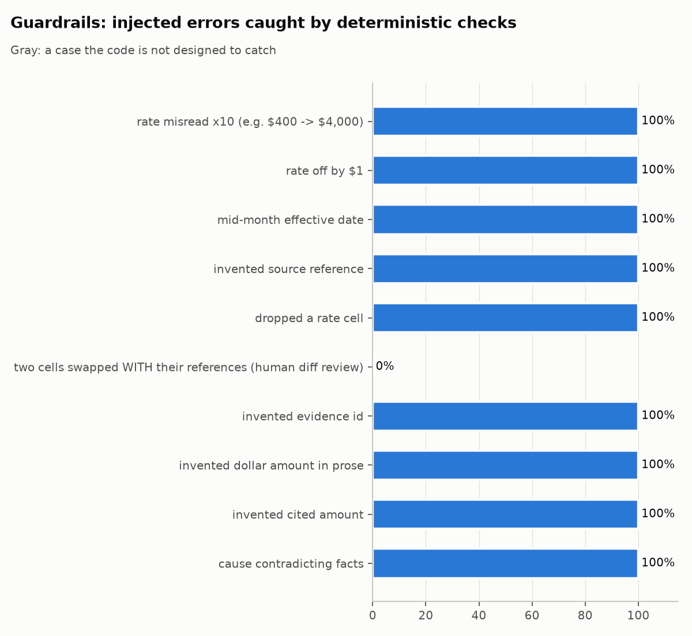
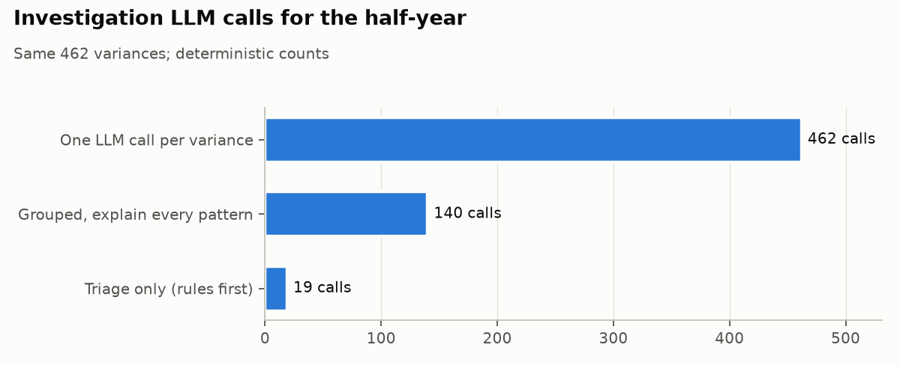

# Evaluation results

Provider: `anthropic` · ground truth: `data/ground_truth` (seed 20260101) · replay reproducible: **True**

## Headline

| Area | Result |
|---|---|
| Rate extraction (3 formats) | 34/34 cells exact |
| Detection of seeded payment issues | 100.0% recall, 0 false positives |
| Classification, rules only | 94.6% exact (25 unresolved) |
| Classification, rules + LLM | 97.4% exact |
| Findings passing evidence + amount checks | 99.3% (139/140) · memos 2/2 (checks passed, not a guarantee of correctness) |
| Retro deltas vs. truth | 100.0% of member-months exact · total 23931.00 (truth 23931.00) |
| Bank reconciliation | 5/5 seeded cases correct |
| Guardrails (injected errors) | 100.0% caught of the cases they're designed for |
| Privacy | 0 leaks in 16868 records · 100.0% of injected PHI blocked |
| LLM calls | 462 per-variance → 140 grouped → 19 triage-only |
| LLM cost | uncached run ≈ $0.0793 (from token counts) · this run's new spend $0 (replay from cache) |

## 1. Rate extraction

| Version | Format | Cells exact | Dates correct | Extra cells | Kind | Retro flag | Published date | Validation errors / flags |
|---|---|---|---|---|---|---|---|---|
| v1 | pdf | 16/16 (100.0%) | 100.0% | 0 | ✓ | ✓ | ✓ | 0 / 0 |
| v2 | xlsx | 16/16 (100.0%) | 100.0% | 0 | ✓ | ✓ | ✓ | 0 / 0 |
| v3 | email | 2/2 (100.0%) | 100.0% | 0 | ✓ | ✓ | ✓ | 0 / 1 |

## 2. Detection (expected vs. state-remitted, member-month)

340/340 seeded payment issues flagged (100.0%); 0 false positives across 9950 clean member-months.

| Code | Seeded | Detected | Recall |
|---|---|---|---|
| DUPLICATE_PAYMENT | 25 | 25 | 100.0% |
| MISSING_FROM_REMIT | 60 | 60 | 100.0% |
| RATE_CELL_MISMATCH | 45 | 45 | 100.0% |
| RECOUPMENT | 23 | 23 | 100.0% |
| STALE_RATE | 175 | 175 | 100.0% |
| UNEXPECTED_PAYMENT | 30 | 30 | 100.0% |

## 3. Classification: rules only vs. rules + LLM

| | Rules only | Rules + LLM |
|---|---|---|
| All variances (n=462), exact cause set | 94.6% | 97.4% |
| Single-cause (n=437) | 100.0% | 100.0% |
| Multi-cause (n=25), exact set | 0.0% | 52.0% |
| Left unresolved for a human | 25 | 0 |

Rules settle single-cause cases at no cost; ambiguous and multi-cause cases go to the LLM.

## 4. Groundedness

139/140 findings passed every implemented check (evidence IDs exist, every $ matches a computed value, cause consistent with facts). Passing the checks is not proof the explanation is correct (see section 7 for what the checks can't catch). Failing findings go to a human. Problem types: {'cites no evidence': 1}. Memos: 2/2 passed (numbers injected by code).

## 5. Retro (prior-period) accuracy

- Close snapshot + adjustments equals final expected for **10944/10944** member-months.
- Total retro: engine **23931.00**, truth **23931.00** (662 member-months, 2 adjustments).
- Remaining-to-collect from the state matches truth for 100.0% of retro member-months.

## 6. Bank reconciliation

| Seeded case | Remit | Deposit | Correct |
|---|---|---|---|
| BANK_TIMING | R-2026-02 | D0002 | ✓ |
| BANK_SHORT | R-2026-03 | D0003 | ✓ |
| NO_REFERENCE | R-2026-04 | D0004 | ✓ |
| BANK_TIMING | R-2026-05 | D0005 | ✓ |
| UNMATCHED_DEPOSIT | - | D9001 | ✓ |

Clean remittances left unflagged: True.

## 7. Guardrails (adversarial)

| Injected into | Injection | Caught |
|---|---|---|
| extraction | rate misread x10 (e.g. $400 -> $4,000) | 3/3 |
| extraction | rate off by $1 | 3/3 |
| extraction | mid-month effective date | 3/3 |
| extraction | invented source reference | 3/3 |
| extraction | dropped a rate cell | 2/2 |
| extraction | two cells swapped WITH their references *(not designed to catch: the approver's diff review is the control)* | 0/2 |
| findings | invented evidence id | 40/40 |
| findings | invented dollar amount in prose | 40/40 |
| findings | invented cited amount | 40/40 |
| findings | cause contradicting facts | 40/40 |

## 8. Privacy

| Source scanned | Records | Leaks |
|---|---|---|
| llm_cache | 1058 | 0  |
| egress_log | 15794 | 0  |
| audit_payloads | 16 | 0  |

Injection test: 200/200 payloads carrying a name, DOB or forbidden field were blocked.

## 9. Cost, latency, caching

| | Recorded run | Replay run |
|---|---|---|
| calls | 145 | 145 |
| cache_hit_pct | 93.8 | 100.0 |
| uncached_equivalent_usd | 0.0793 | 0.0793 |
| new_spend_usd | 0.0100631 | 0 |
| wall_seconds | 97.1 | 23.1 |

Calls by task: {'investigate_complex': 19, 'investigate_simple': 121, 'memo': 2, 'rate_extraction': 3}. Models by task: {'investigate_complex': {'claude-haiku-5-5': 19}, 'investigate_simple': {'claude-haiku-5-5': 121}, 'memo': {'claude-haiku-5-5': 2}, 'rate_extraction': {'claude-haiku-5-5': 3}}.

**How to read cost:** `uncached_equivalent_usd` is what this exact run would cost with an empty cache, priced from every response's token counts. `new_spend_usd` is what this run actually paid; a replay from cache pays $0. The cumulative spend across all live calls made for this project was about $0.35.
